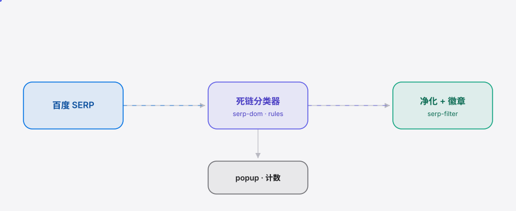

<div align="right"><sub><b>English</b>&nbsp;&nbsp;⇄&nbsp;&nbsp;<a href="./README.md">简体中文</a></sub></div>

<picture>
  <source media="(prefers-color-scheme: dark)" srcset="./assets/hero-dark.svg">
  <source media="(prefers-color-scheme: light)" srcset="./assets/hero-light.svg">
  
</picture>

<p align="center"><sub>CleanSERP is the zero-config SERP overlay that hides marketing-account dead-ends for Chinese search users.</sub></p>

<p align="center">
  <a href="./LICENSE"></a>
  <a href="https://github.com/SuperMarioYL/cleanserp/releases"></a>
  
  
  
  
</p>

**Every Baidu/Sogou search makes you click through 5+ marketing-account posts, Baidu Baijiahao AI listicles, and paywall dead-links before one source is actually readable — CleanSERP works the moment you install it. No account, no engine switch.**

## Table of contents

- [Why this exists](#why-this-exists)
- [Architecture](#architecture)
- [Install](#install)
- [Quickstart](#quickstart)
- [Usage](#usage)
- [Demo](#demo)
- [Configuration](#configuration)
- [Pro tier](#pro-tier)
- [Roadmap](#roadmap)
- [License & contributing](#license--contributing)

## Why this exists

Baidu/Sogou SERPs are flooded with Baijiahao AI listicles and marketing-account dead-ends — every search makes you click through 5+ useless results before one source is readable. uBlock hides ad slots but leaves the junk in organic results untouched; Kagi requires switching engines and paying. CleanSERP overlays a **zero-config content-quality filter** on top of your existing Baidu — install it and only readable sources remain, with a "CleanSERP filtered N items" badge up top telling you how much noise was cleaned today.

## Architecture

<h2> Architecture</h2>

CleanSERP is a single extension process: a content script parses the rendered Baidu SERP, hands each result to a heuristic dead-end classifier (rules.ts), cards matching one of four dead-end classes are hidden inline, and a filter badge is injected at the top. A service worker stores the count per tab; the popup shows the current count. The rule set is independently swappable, leaving a seam for future Pro custom rules.

<picture>
  <source media="(prefers-color-scheme: dark)" srcset="./assets/atlas-dark.svg">
  <source media="(prefers-color-scheme: light)" srcset="./assets/atlas-light.svg">
  
</picture>

The classifier primitive is a rule combination (not ML), returning a `usable` / `dead-end` verdict plus a dead-end reason per result:

```typescript
type DeadEndReason = "baijiahao-ai-slop" | "yingxiaohao" | "paywall" | "redirect-middlepage";
function classify(r: SerpResult): { verdict: Verdict; reason?: DeadEndReason };
```

## Install

<h2> Install</h2>

Requires Node 22+ (for building). At runtime all you need is Chrome / Edge (MV3).

```bash
git clone https://github.com/SuperMarioYL/cleanserp.git
cd cleanserp && npm install && npm run build
```

## Quickstart

<h2> Quickstart</h2>

1. Open `chrome://extensions` and enable "Developer mode" (top-right).
2. Click "Load unpacked" and select the `dist/` directory in the repo.
3. Open [baidu.com](https://www.baidu.com) and search "怎么治疗脱发" — dead-end results disappear instantly and a "净搜已过滤 N 条" badge appears at the top.

<details><summary>Sample output (terminal build)</summary>

```
$ npm run build
> cleanserp@0.1.0 build
> node scripts/build.mjs
  dist/src/content/serp-filter.js       2.1kb
  dist/src/background/service-worker.js 1.4kb
  dist/src/popup/popup.js               1.1kb
  dist/tests/serp-filter.test.js        3.0kb
build: dist/ ready for load-unpacked
```

</details>

## Usage

<h2> Usage</h2>

- **Purify Baidu search**: after install, visit `baidu.com/s?wd=...` — the content script runs the classifier once and hides dead-ends, with a MutationObserver catching pagination and async re-renders.
- **See the current count**: click the CleanSERP toolbar icon; the popup shows "filtered N items" for the active tab.
- **Reload rules**: edit `src/content/rules.ts` → `npm run build` → click the extension's "Reload" on `chrome://extensions`.

The on/off toggle and Sogou support are v0.2 scope (see [Roadmap](#roadmap)).

## Demo

<h2> Demo</h2>

Searching "怎么治疗脱发" on Baidu: five marketing-account / Baijiahao-AI / paywall dead-ends vanish instantly, leaving one clean readable result with a "净搜已过滤 5 条" badge at the top.


> The recording script is [`docs/demo.tape`](./docs/demo.tape) (vhs); `.github/workflows/demo.yml` re-renders `assets/demo.gif` on demand.

## Configuration

<h2> Configuration</h2>

CleanSERP has no settings page — all state lives in `chrome.storage.local` (zero-config is the core thesis):

| key | type | default | meaning |
| --- | --- | --- | --- |
| `cleanserp_enabled` | boolean | `true` | Global toggle. Defaults on in v0.1; the on/off switch UI is v0.2 scope |
| `cleanserp_count_<tabId>` | number | `0` | Filtered count for that tab |
| `cleanserp_engine_<tabId>` | `"baidu"` \| `"sogou"` | `"baidu"` | Engine hit on that tab (Sogou added in v0.2) |

## Pro tier

CleanSERP v0.1 is fully free and open source; personal filtering is free forever. Commercialization is a future Pro tier for e-commerce ops / content teams (3–10 people):

- **Pro capabilities**: a custom, editable rule list (permanently filter specific competitor marketing domains / title patterns) + team rule sharing + cloud sync (across machines / teammates).
- **Pricing**: ¥39 / user / month, or ¥199 / team / month (≤5 people) — below the psychological threshold of an e-commerce tool, above what an individual would pay to "hide Baidu ads" (individuals should be free).
- **Smallest paid path**: an e-commerce team lead uses the free version to search competitor brand terms → wants to permanently filter a specific marketing domain → hits the "Pro: add custom rule" gate → pays ¥39/month via WeChat Pay → the rule syncs to the cloud and they invite teammates.
- **Billing stack**: WeChat Pay (or a CN-friendly Lemon Squeezy fallback) + a self-hosted rule-sync API (Node 22 + Postgres, same stack as the extension).

Pro is not implemented in v0.1; the rule engine is kept pluggable so it can be added later.

## Roadmap

<h2> Roadmap</h2>

- [x] **m1** Baidu SERP dead-end classifier (Baijiahao AI slop / marketing accounts / paywall / redirect middle-pages) + "filtered N items" badge
- [ ] **m2** popup on/off toggle + current filtered count + basic Sogou SERP support (reusing the serp-dom adapter)
- [ ] **m3** Chrome/Edge Web Store MV3 packaging (manifest, icons, screenshots, listing) + 30s GIF demo + bilingual README
- [ ] **Pro** custom editable rule list + team rule sharing + cloud sync
- [ ] "Reveal hidden content" per-item expander (v0.2+)

## License & contributing

<h2> License & contributing</h2>

MIT license, see [LICENSE](./LICENSE). File feedback like "which queries filter poorly" or rule-patch PRs at [GitHub Issues](https://github.com/SuperMarioYL/cleanserp/issues) — when Baidu's SERP DOM churns, just edit `src/content/rules.ts`.

<p align="center"><sub><a href="./LICENSE">MIT</a> © 2026 SuperMarioYL</sub></p>
