[English](./README.en.md) · [Website](https://cleanserp.lei6393.com) · [GitHub](https://github.com/SuperMarioYL/cleanserp)

<picture>
  <source media="(max-width: 600px) and (prefers-color-scheme: dark)" srcset="./assets/presentation/hero-mobile-dark.svg">
  <source media="(max-width: 600px)" srcset="./assets/presentation/hero-mobile-light.svg">
  <source media="(prefers-color-scheme: dark)" srcset="./assets/presentation/hero-dark.svg">
  
</picture>

# cleanserp

**点开链接之前，先筛掉命中规则的结果。**

净搜对已渲染的百度/搜狗搜索结果应用本地启发式规则，隐藏命中的卡片，并显示过滤数量。

## 为什么需要它

搜索摘要中已有推广标记、登录提示和跳转链接等信号。净搜根据这些可见信息减少重复筛选，规则可以直接检查和修改。

- **本地分类** — 无需 API 调用即可分类可见结果字段。
- **可检查的原因** — 命中结果带有具体规则类别。
- **沿用搜索页面** — content script 直接作用于已有百度/搜狗结果页。

## 架构

<picture>
  <source media="(max-width: 600px) and (prefers-color-scheme: dark)" srcset="./assets/presentation/architecture-mobile-dark.svg">
  <source media="(max-width: 600px)" srcset="./assets/presentation/architecture-mobile-light.svg">
  <source media="(prefers-color-scheme: dark)" srcset="./assets/presentation/architecture-dark.svg">
  
</picture>

content script 按引擎自动选择解析器（百度/搜狗），提取结果字段并调用纯函数 classify，隐藏命中卡片，再把计数与引擎传给扩展界面。popup 的 on/off 开关翻转后已过滤页面即时生效；底部折叠条可逐条查看并恢复被隐藏结果。

| 组件 | 职责 |
| --- | --- |
| `Baidu/Sogou DOM` | src/lib/serp-dom.ts |
| `Rule classifier` | src/content/rules.ts |
| `Content script` | src/content/serp-filter.ts |
| `Popup state` | service worker + popup |

## 安装与快速上手

使用仓库清单指定的运行时版本构建，并在仓库根目录运行示例。

```bash
git clone https://github.com/SuperMarioYL/cleanserp.git
cd cleanserp
npm ci
npm run build
```

独立示例包含三条完整合成结果对象，并运行生产 classify 函数。

```bash
node examples/presentation-demo.mjs
```

## 实际运行示例

<picture>
  <source media="(max-width: 600px) and (prefers-color-scheme: dark)" srcset="./assets/presentation/process-mobile-dark.svg">
  <source media="(max-width: 600px)" srcset="./assets/presentation/process-mobile-light.svg">
  <source media="(prefers-color-scheme: dark)" srcset="./assets/presentation/process-dark.svg">
  
</picture>

The documentation result is usable; the listicle and login-wall examples match explicit rules.

```text
{"title":"JavaScript reference","verdict":"usable"}
{"title":"一文读懂 5 个技巧","verdict":"dead-end","reason":"baijiahao-ai-slop"}
{"title":"Members article","verdict":"dead-end","reason":"paywall"}
```

完整命令与输出保存在 [docs/demo-results.json](./docs/demo-results.json). 输入和复现代码均随仓提供。


保留已有录制供参考；上方文字示例给出当前可复现的操作。

## 用法

CLI 提供以下操作。示例之外的命令需要替换成你的文件路径或标识。

```bash
npm run build
# Load dist/ in chrome://extensions (Developer mode).
npm run typecheck
npm test
```

## 配置

修改 src/content/rules.ts 调整本地匹配规则，重新构建后重载已解包扩展。无需账号；扩展申请 storage 与百度/搜狗站点访问权限。

## 集成与职责分工

<picture>
  <source media="(max-width: 600px) and (prefers-color-scheme: dark)" srcset="./assets/presentation/integrations-mobile-dark.svg">
  <source media="(max-width: 600px)" srcset="./assets/presentation/integrations-mobile-light.svg">
  <source media="(prefers-color-scheme: dark)" srcset="./assets/presentation/integrations-dark.svg">
  
</picture>

以下路径已有源码实现。按任务选择输入，并把生成的结果与项目一起保存。

| 路径 | 已实现职责 |
| --- | --- |
| Baidu/Sogou pages | Manifest content-script matches |
| Result fields | URL, title, snippet and source |
| Chrome storage | Per-tab filtering state |
| MV3 bundle | Load unpacked from dist/ |

## 限制与后续方向

- 规则属于启发式判断。baijiahao-ai-slop 等标签是规则分类，不证明作者使用 AI，也不证明页面无法访问。
- 桌面版百度（www.baidu.com）与搜狗（www.sogou.com/web）自然结果已支持：两个解析适配器均对仓库内 fixture 做回归测试，但两家 SERP DOM 都频繁 A/B 变更，不保证实时页面兼容性。
- 移动端 SERP（m.baidu.com / m.sogou.com）DOM 结构与桌面不同，当前选择器为桌面版：移动端注入为无害 no-op（解析 0 卡 ⇒ 不过滤、无徽章），待真机验证条件具备后再适配。
- 搜狗垂直搜索（图片/视频/微信 tab）不在支持范围。
- 离线示例在合成输入上运行生产分类器，不验证实时页面兼容性或搜索质量。

被隐藏卡片的查看入口与独立验证的引擎适配器已在 v0.2.0 落地（底部折叠条 + 单条恢复；百度/搜狗适配器均有 fixture 回归测试）。移动端适配与共享自定义规则仍是后续工作。

## 许可与贡献

许可见 [LICENSE](./LICENSE). 反馈问题时请提供最小输入、执行命令和实际输出。
